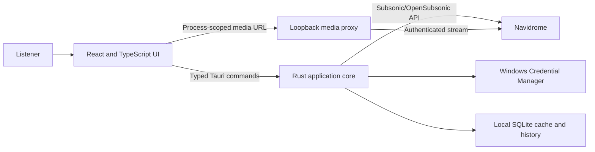

<p align="center">
  
</p>

<h1 align="center">Pocket Player</h1>

<p align="center"><strong>Your self-hosted music library, without the browser.</strong></p>

Pocket Player is a security-conscious, native-feeling client for people who self-host music with [Navidrome](https://www.navidrome.org/). It turns a browser-bound listening workflow into a dedicated Windows experience with dependable playback, fast library navigation, explainable discovery, local listening insights, and native desktop controls. Android support is in technical preview.

> **Project status:** Working `0.1.0` source implementation. The core Windows experience is implemented and covered by automated checks; real-library release validation remains manual. Android has an adaptive interface and session-only credential strategy but is not yet release-ready. Signed public distribution and automatic updates are not available.

For the short product narrative, prioritisation rationale, and validation plan, read the [product case study](docs/PRODUCT_CASE_STUDY.md).

## At a glance

|                     |                                                                                                                                           |
| ------------------- | ----------------------------------------------------------------------------------------------------------------------------------------- |
| **Problem**         | Everyday Navidrome listening still depends on managing a browser tab and lacks a cohesive native player experience.                       |
| **Primary user**    | A privacy-conscious listener who already owns and self-hosts a personal music library with Navidrome.                                     |
| **Core job**        | Find and play personal music quickly, keep control of playback anywhere on the device, and rediscover underplayed tracks.                 |
| **MVP scope**       | One active Navidrome profile, online streaming, a dedicated Windows app, and an adaptive Android technical preview.                       |
| **Differentiation** | Deterministic playback, explainable discovery mixes, rich metadata navigation, local-only insights, and privacy by design.                |
| **Product stage**   | Portfolio alpha: substantial implementation, automated verification, and a documented manual release checklist; no signed public release. |

This repository records both the product and the reasoning behind it: problem framing, goals and non-goals, phased prioritisation, acceptance criteria, technical decisions, delivery status, and open validation questions.

## Product challenge

Navidrome already solves music ownership and server-side access well. The remaining gap is the daily listening experience: starting music without opening a browser, retaining a reliable queue across navigation and restarts, using system-level controls, and finding forgotten music without handing listening data to another cloud service.

The initial job-to-be-done is a first-party product hypothesis:

> When I listen to my Navidrome library every day, I want reliable playback and system controls without managing a browser tab, so my private collection feels like a dedicated music service.

The product deliberately complements Navidrome instead of becoming another server. Navidrome remains the source of truth for music, metadata, favourites, ratings, playlists, permissions, and server play counts.

## The experience

### Listen reliably

- One persistent playback owner survives route changes and controls both the main window and mini player.
- Deterministic queue actions support play now, play next, append, duplicates, jump, reorder, remove, shuffle, repeat, persistence, and server synchronisation.
- Scrobbling uses actual listened time and duplicate protection instead of treating a seek near the end as a completed play.
- Plain and synchronised lyrics are displayed when the server exposes them.

### Find anything in a personal library

- Browse Home, albums, artists, tracks, genres, exact genre/mood tags, favourites, and playlists.
- Search artists, albums, and tracks with a short debounce and grouped results.
- Use a profile-scoped SQLite metadata index for whole-library filtering, exact tag navigation, and numeric or technical sorting before pagination.
- Follow typed artist and album links across search, tables, playlists, the queue, statistics, and player surfaces without guessing opaque Navidrome IDs.

### Rediscover music intentionally

- Generate transparent mixes that balance familiar, underplayed, recent, related, and broad-discovery sources.
- Adjust a Familiar-to-Adventurous control while retaining diversity safeguards.
- See a reason for each selected track and warnings when the server cannot supply a candidate source.
- Review device-local listening statistics that are explicitly labelled as incomplete outside this app.

### Control playback like a desktop app

- Use a persistent player, a separate always-on-top mini player, tray controls, media keys, track notifications, and close-to-tray behaviour.
- Starting a second copy focuses the existing process instead of creating another playback owner.
- Choose from 22 trusted Canvas and WebGL visualisers with local audio analysis, fullscreen controls, reduced-motion handling, and adaptive rendering quality.

## Product strategy

Delivery was sequenced by risk and user value, not by feature count:

1. **Establish trust and playback.** Validate secure authentication, safe streaming, one persistent player, and exactly-once scrobbling.
2. **Complete the daily library job.** Add search, browsing, playlists, favourites, ratings, queue editing, and restart persistence.
3. **Remove desktop friction.** Add the mini player, tray, media controls, notifications, and single-instance behaviour.
4. **Create a reason to choose the product.** Add explainable discovery and clearly scoped local insights only after playback is dependable.
5. **Polish without widening the trust boundary.** Add lyrics and trusted visualisers that share the existing audio graph.
6. **Gate distribution on real prerequisites.** Signing, updates, and store delivery remain pending rather than being presented as shipped.

The complete requirements, non-goals, and acceptance criteria live in the [product specification](PRODUCT_SPEC.md). The [roadmap](ROADMAP.md) separates implemented source, validation work, external dependencies, and evidence-triggered later bets.

## Delivery status

| Area                            | Current evidence                                                                                                    | Status                                                                            |
| ------------------------------- | ------------------------------------------------------------------------------------------------------------------- | --------------------------------------------------------------------------------- |
| Secure connection and streaming | Token-and-salt authentication, Windows Credential Manager, typed Rust client, loopback media proxy, redaction tests | Implemented in source                                                             |
| Library and playback            | Full route set, SQLite metadata index, queue persistence/sync, favourites, ratings, playlists, scrobble protections | Implemented in source                                                             |
| Windows experience              | Mini player, tray, media session actions, notifications, close-to-tray, single instance                             | Implemented in source; manual release checks remain                               |
| Discovery and insight           | Explainable mix engine, configurable Home, local playback events and statistics                                     | Implemented in source; outcome validation pending                                 |
| Lyrics and visualisation        | Plain/synchronised lyrics and 22 trusted adaptive visualisers                                                       | Implemented in source                                                             |
| Android                         | Shared adaptive shell, safe-area handling, touch targets, and session-only credentials                              | Technical preview; device and packaging validation pending                        |
| Public distribution             | Windows bundle configuration and local build process                                                                | Blocked on signing identity, protected keys, updater endpoint, and release policy |

This status describes repository evidence, not customer adoption or production readiness. The project sends no telemetry by default, has no published usage metrics, and does not claim external market validation.

## Key decisions and trade-offs

| Decision                                       | User or product benefit                                                         | Accepted trade-off                                                                      |
| ---------------------------------------------- | ------------------------------------------------------------------------------- | --------------------------------------------------------------------------------------- |
| Rust owns Navidrome networking and credentials | Reusable secrets and authenticated upstream URLs stay out of the webview        | Every server capability needs a typed facade method                                     |
| One HTML audio owner across all windows        | Navigation and mini-player actions cannot create duplicate streams or scrobbles | Crossfade is deferred; advanced audio behaviour depends on the platform media stack     |
| HTML media before MPV                          | Smaller packaging, security, and update surface                                 | Gapless playback, ReplayGain, device selection, and some codecs remain validation items |
| Local SQLite index and history                 | Responsive whole-library search, exact tags, and richer local insight           | Statistics cover only playback observed by this installation                            |
| One active profile in the initial UI           | Unambiguous credential, queue, cache, and playback ownership                    | Multi-profile convenience is deferred                                                   |
| Trusted built-in visualisers only              | Rich local visuals without executing downloaded code                            | No third-party preset ecosystem                                                         |

Major technical choices are documented as [architecture decision records](docs/decisions/README.md), not hidden in implementation details.

## Success framework

Targets and evidence are intentionally separated. Automated checks show that behaviour is implemented; they do not prove customer outcomes.

| Outcome                 | Signal or guardrail                                                                  | Current evidence                                                                   |
| ----------------------- | ------------------------------------------------------------------------------------ | ---------------------------------------------------------------------------------- |
| Fast activation         | App shell visible within 2 seconds; first successful connection and track start      | Product target defined; real-device benchmark and funnel baseline pending          |
| Fast retrieval          | Search begins within 300 ms after typing stops                                       | 250 ms debounce implemented; representative large-library benchmark pending        |
| Dependable listening    | Playback survives navigation/window changes; qualifying plays scrobble once          | Unit/integration coverage plus a documented real-server release checklist          |
| User trust              | Zero plaintext passwords, reusable auth URLs, or secrets in logs/webview persistence | Rust-owned boundary, Credential Manager, CSP, redaction, and security tests        |
| Useful discovery        | Mix starts, play-through, skip rate, and acceptance of underplayed tracks            | Explainable selection implemented; consented/local outcome measurement not yet run |
| Distribution confidence | Signed install, update, upgrade, and rollback checks                                 | External release inputs outstanding                                                |

If the product moves beyond owner-operated use, the next discovery step is a small set of observed onboarding and daily-listening sessions with existing Navidrome users, followed by a baseline for the measures above. No analytics should be added without an explicit privacy decision.

## How it works



The frontend never calls Navidrome directly. Rust validates the configured host, creates authenticated requests, owns credentials and local persistence, and exposes a narrow typed Tauri facade. Audio and artwork use a random, process-scoped loopback route so authenticated Navidrome URLs do not enter the webview.

### Technology

- **Application:** Tauri 2
- **Frontend:** React, TypeScript, Vite, TanStack Query, Zustand, Zod
- **Backend:** Rust, Reqwest, Axum, SQLite
- **Quality:** Vitest, React Testing Library, Rust unit tests, and mock-server integration tests

See [ARCHITECTURE.md](ARCHITECTURE.md) for trust boundaries, playback ownership, persistence, proxy design, and testing strategy.

## Security and privacy by design

- Navidrome credentials and networking remain on the Rust side.
- Remembered Windows passwords live in Windows Credential Manager; Android credentials are session-only until a reviewed Keystore implementation exists.
- Authentication uses a fresh random salt for each supported Subsonic request; the clear-text password is never placed in a query parameter.
- The media proxy binds to loopback, accepts only narrow media routes, and uses a random per-process token.
- TLS validation and Tauri's Content Security Policy remain enabled.
- Tauri capabilities are window-specific and least-privilege.
- Local statistics are stored on-device, clearly scoped, and never presented as complete cross-client history.
- Diagnostics redact credentials, authenticated URLs, usernames, and the loopback token.

Please use the private process in [SECURITY.md](SECURITY.md) for suspected vulnerabilities and never include real credentials, server addresses, library metadata, or authenticated URLs in a report.

## Run locally on Windows

### Prerequisites

- Windows 10 or 11 with WebView2
- Node.js 22 or newer and npm
- Rust stable with the MSVC toolchain, `rustfmt`, and `clippy`
- Visual Studio Build Tools with Desktop development with C++ and a Windows SDK
- Access to an existing Navidrome server for manual use

### Start the app

```powershell
npm install
npm run tauri dev
```

No `.env` file is required. Enter a server URL and credentials only in the running app; never place them in source, fixtures, screenshots, or environment files.

If PowerShell blocks the npm script shim, use `npm.cmd` instead. Full toolchain setup and troubleshooting are in [DEVELOPMENT.md](DEVELOPMENT.md).

### Verify a change

```powershell
npm run verify
```

The verification gate runs formatting, linting, strict TypeScript checks, frontend tests, Rust formatting, Clippy with warnings denied, and Rust tests. Automated server tests use local mocks and do not require personal Navidrome credentials. Real account, playback, mutation, and package checks remain part of the manual release checklist.

## Repository guide

```text
src/                       React application and typed Tauri facade
src/features/player/       Single playback owner, queue, scrobbling, mini player
src/features/mix/          Discovery experience
src/features/visualizer/   Trusted Canvas/WebGL visualisers
src-tauri/src/             Rust commands, Navidrome client, proxy, persistence
src-tauri/tests/           Mock-server integration tests
docs/decisions/            Architecture decision records
```

| Document                                         | Purpose                                                                                        |
| ------------------------------------------------ | ---------------------------------------------------------------------------------------------- |
| [Product case study](docs/PRODUCT_CASE_STUDY.md) | Concise PM narrative, prioritisation, trade-offs, measures, risks, and next validation         |
| [Product specification](PRODUCT_SPEC.md)         | Problem, users, goals, non-goals, requirements, phases, and MVP acceptance criteria            |
| [Roadmap](ROADMAP.md)                            | Implemented scope, validation status, external dependencies, and evidence-triggered later work |
| [Architecture](ARCHITECTURE.md)                  | System boundaries, data ownership, security model, playback design, and testing strategy       |
| [Decision records](docs/decisions/README.md)     | Durable context for major product/technical trade-offs                                         |
| [User guide](USER_GUIDE.md)                      | Current workflows, controls, privacy behaviour, and troubleshooting                            |
| [Development guide](DEVELOPMENT.md)              | Windows setup, commands, local data, release checklist, and troubleshooting                    |
| [Contributing](CONTRIBUTING.md)                  | Change workflow, architectural constraints, and review checklist                               |
| [Security policy](SECURITY.md)                   | Private reporting guidance and security scope                                                  |
| [MIT License](LICENSE)                           | Permission to use, modify, and redistribute Pocket Player                                      |
| [Third-party notices](THIRD_PARTY_NOTICES.md)    | Dependency licensing boundary and binary-release compliance requirements                       |

## Known limitations

- There is no signed public installer, updater, or supported release channel yet.
- Android remains a technical preview and does not persist credentials between sessions.
- The UI exposes one active server profile; multi-profile foundations do not equal a multi-profile product experience.
- Playback is online-only. Offline downloads and iOS are outside the initial scope.
- Crossfade is not implemented, and exact gapless, ReplayGain, output-device, and codec behaviour depends on the HTML/platform media stack.
- Listening statistics represent this installation only.
- Automated integration tests use mock servers; the owner must complete the real-Navidrome checklist before a release claim.
- Safe product screenshots and a public demo are still needed. Existing personal test captures are intentionally excluded from the repository.

## Contributing

Feedback and well-scoped changes are welcome. Start with [CONTRIBUTING.md](CONTRIBUTING.md), preserve the security and single-playback-owner invariants, and run `npm run verify` before requesting review.

## Project and licence notes

Pocket Player is an independent client and is not affiliated with or endorsed by the Navidrome project.

Copyright (c) 2026 Edward Chaput de Saintonge. Pocket Player is available under the [MIT License](LICENSE), which permits use, copying, modification, and redistribution when the copyright and permission notice is retained. The software is provided without warranty.

Third-party components retain their own terms. See [THIRD_PARTY_NOTICES.md](THIRD_PARTY_NOTICES.md) for the dependency boundary and the licence-audit requirements that apply before distributing a binary release.
